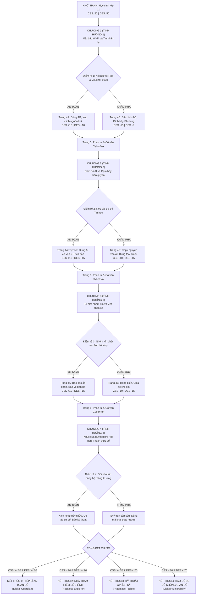

# KỊCH BẢN TỔNG THỂ: NGƯỜI GÁC ĐỀN KHÔNG GIAN SỐ
## HÀNH TRÌNH TRƯỞNG THÀNH TRÊN MẠNG CỦA MINH VÀ AN

> **Dành cho:** Học sinh lớp 11 (Chương trình GDPT 2018 môn Tin học)  
> **Chủ đề tích hợp:** Chủ đề B (An toàn thông tin) & Chủ đề D (Đạo đức số, bản quyền, AI)  
> **Thể loại:** Truyện lật tương tác phân nhánh (Interactive Fiction / Visual Novel Flipbook)

---

## 👥 1. TUYẾN NHÂN VẬT CHÍNH

1. **MINH (Nhân vật chính - Người học nhập vai):**
   - Học sinh lớp 11 chuyên ban Tin học ứng dụng. Thông minh, nhanh nhẹn, tò mò về công nghệ, thích tìm hiểu các thủ thuật máy tính mới nhưng đôi lúc chủ quan và dễ bị cuốn vào những trào lưu mạng mạo hiểm.
2. **AN (Bạn thân cùng bàn của Minh):**
   - Cẩn thận, chín chắn, luôn tuân thủ nguyên tắc an toàn, có ý thức cao về liêm chính học thuật và bảo vệ dữ liệu cá nhân. An đóng vai trò người phản biện, đưa ra những lời cảnh báo kịp thời cho Minh.
3. **HOÀNG (Bạn cùng lớp):**
   - Đại diện cho xu hướng "thích đốt cháy giai đoạn": thích tải phần mềm lậu bẻ khóa (Crack), thích dùng AI làm trọn gói bài tập để lấy điểm cao, thích tham gia vào các nhóm chat "hóng biến" thị phi.
4. **CYBERFOX (Cố vấn ảo thông thái):**
   - Linh vật trợ lý an ninh mạng xuất hiện ở trang phản tư cuối mỗi chương. Hóm hỉnh, sâu sắc, giải thích cơ chế kỹ thuật và nâng đỡ nhận thức cho học sinh (Scaffolding).

---

## 📊 2. HỆ THỐNG CHỈ SỐ TRẠNG THÁI (DUAL-TRACK METRICS)

Người chơi bắt đầu với điểm số khởi điểm:
- 🛡️ **Điểm An toàn thông tin (CSS - Cyber Safety Score):** Khởi điểm = **50/100**
- 💡 **Điểm Đạo đức số & Trách nhiệm (DES - Digital Ethics Score):** Khởi điểm = **50/100**

Mỗi quyết định sẽ cộng hoặc trừ trực tiếp vào các chỉ số này:
- Lựa chọn nhánh **AN TOÀN**: Tăng từ `+10` đến `+15` điểm CSS / DES.
- Lựa chọn nhánh **KHÁM PHÁ / MẠO HIỂM**: Đem lại trải nghiệm hiểu biết mới nhưng có thể giảm `-15` điểm CSS (nếu gặp sự cố bảo mật) hoặc giảm `-15` điểm DES (nếu xâm phạm đạo đức).

---

## 🗺️ 3. SƠ ĐỒ CÂY QUYẾT ĐỊNH TỔNG THỂ (DECISION TREE)

---

## 🏆 4. ĐẶC TẢ 4 KẾT THÚC ĐA CHIỀU (MULTIPLE ENDINGS)

1. **KẾT THÚC 1: HIỆP SĨ AN TOÀN SỐ (Digital Guardian)**
   - *Điều kiện:* CSS ≥ 70 và DES ≥ 70.
   - *Ý nghĩa:* Học sinh làm chủ hoàn hảo cả kỹ năng kỹ thuật lẫn đạo đức nhân văn. Trở thành Đại sứ an toàn thông tin của trường, được thầy cô tin tưởng và bạn bè noi theo.
2. **KẾT THÚC 2: NHÀ THÁM HIỂM LIỀU LĨNH (Reckless Explorer)**
   - *Điều kiện:* CSS < 70 và DES ≥ 70.
   - *Ý nghĩa:* Có lòng tốt và ý thức đạo đức nhưng thiếu kỹ năng phòng vệ kỹ thuật. Rất dễ bị hacker lợi dụng làm bàn đạp tấn công. Bài học: "Lòng tốt cần đi kèm kiến thức bảo mật".
3. **KẾT THÚC 3: KỸ THUẬT GIA ÍCH KỶ (Pragmatic Techie)**
   - *Điều kiện:* CSS ≥ 70 và DES < 70.
   - *Ý nghĩa:* Giỏi kỹ thuật bảo vệ bản thân nhưng bàng quan trước việc bạn bè bị bắt nạt, sẵn sàng dùng AI thiếu liêm chính. Bài học: "Công nghệ không có đạo đức sẽ tạo ra hiểm họa".
4. **KẾT THÚC 4: BÁO ĐỘNG ĐỎ KHÔNG GIAN SỐ (Digital Vulnerability)**
   - *Điều kiện:* CSS < 70 và DES < 70.
   - *Ý nghĩa:* Thiết bị bị nhiễm mã độc, tài khoản bị xâm nhập, rơi vào vòng xoáy thị phi mạng. Học sinh cần được giáo viên đồng hành củng cố lại toàn bộ kiến thức.
